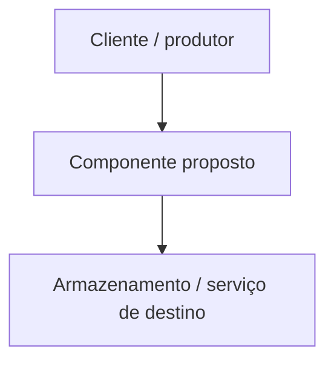

---
# ============================================================================
# Managed section — preserve the document metadata when updating this file
# ============================================================================
id: RFC-0000
type: rfc
title: "Descriptive title of the technical proposal"
status: draft
created_at: YYYY-MM-DD
updated_at: YYYY-MM-DD
# ============================================================================
authors:
  - "@author"
reviewers: []
related_prds: []
tags: []
---

# RFC-0000: Título descritivo da proposta

## Resumo

Em um ou dois parágrafos, explique o que está sendo proposto e o que se ganha com isso.

## Motivação

- Que problema estamos resolvendo?
- Por que resolver agora?
- Quem é afetado: que usuários, serviços ou fluxos de trabalho?

## Objetivos e fora de escopo

### Objetivos
- Objetivo mensurável 1
- Objetivo mensurável 2

### Fora de escopo
- O que esta proposta deliberadamente **não** vai tratar

## Proposta detalhada

Descreva a solução técnica com detalhe suficiente para a revisão da engenharia:
- Arquitetura em alto nível (diagramas Mermaid são bem-vindos)
- Mudanças no modelo de dados, em contratos de API ou em interfaces públicas
- Principais fluxos de execução e como os erros são tratados

## Impacto, riscos e compatibilidade

- **Quebra de compatibilidade**: A mudança quebra a compatibilidade com versões anteriores? Como vai ser a migração?
- **Segurança e privacidade**: Autenticação, autorização, proteção de dados e superfície de ataque.
- **Desempenho e operação**: Consumo de recursos, observabilidade, métricas e estratégia de implantação.

## Alternativas consideradas

### Alternativa A: [nome]
- **Descrição**: Resumo da abordagem alternativa.
- **Por que foi descartada**: O que levou a escolher a proposta principal no lugar desta.

## Pontos em aberto

- [ ] Ponto em aberto 1, a resolver durante a revisão
- [ ] Ponto em aberto 2

## Plano de adoção e documentos derivados

Quando esta RFC for aprovada (`status: approved`), crie os documentos abaixo:

- **ADRs a criar**:
  - [ ] `ADR-NNNN`: [título da decisão de arquitetura que sai desta RFC]
- **Specs a criar**:
  - [ ] `SPEC-NNNN`: [título da especificação que vai guiar a implementação]
- **Runbooks a criar ou atualizar**:
  - [ ] `RUNBOOK-NNNN`: [título do procedimento operacional que sai desta RFC]
